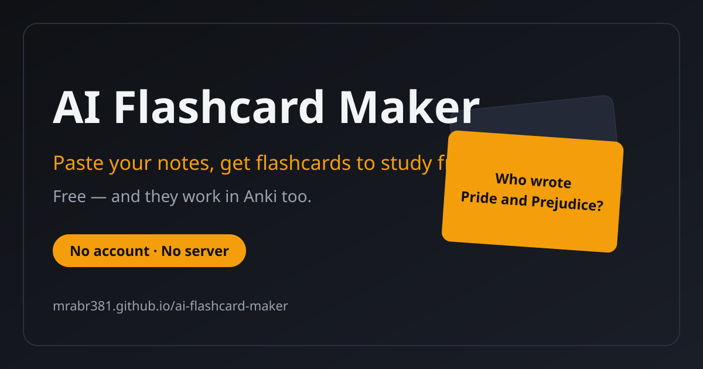
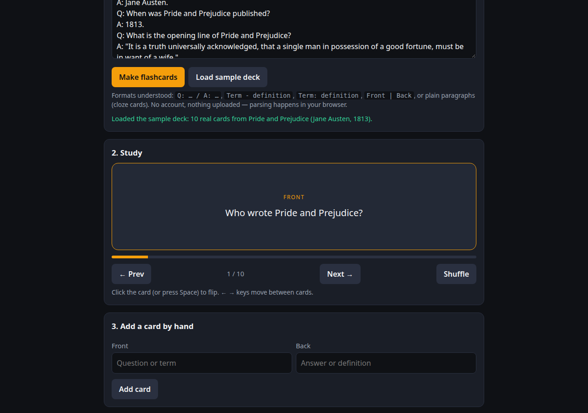
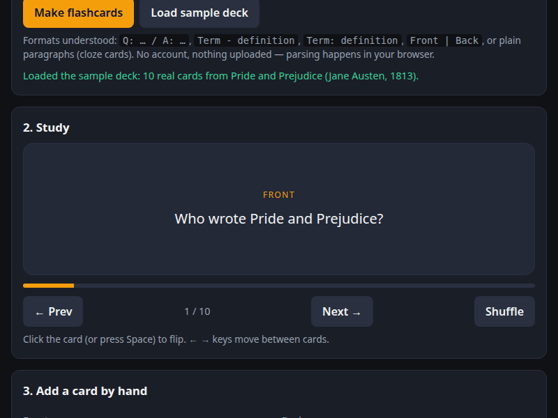

[](https://github.com/mrabr381/ai-flashcard-maker)
[](https://www.buymeacoffee.com/muhammadabubakar)

# AI Flashcard Maker

**Paste your notes, get flashcards to study from — free, and they work in Anki too.**

**Live demo:** https://mrabr381.github.io/ai-flashcard-maker/



*The sample deck loaded — click a card to flip it, ← → to move through the deck.*



## How it works

1. Paste study notes into the box (or press **Load sample deck**).
2. Press **Make flashcards** — cards appear instantly.
3. Click a card to flip it, use ← → to move through the deck.
4. Press **Download Anki CSV** and import it into Anki.

No account. No server. The whole tool is one static page (`index.html`).

## Notes formats it understands

- `Q: …` followed by `A: …` — question / answer cards
- `Term - definition` or `Term: definition` — term cards
- `Front | Back`
- Plain paragraphs — turned into fill-in-the-blank (cloze) cards

You can also add cards by hand, one at a time.

## Importing into Anki

In Anki: **File → Import** → pick the downloaded CSV → field
separator **Comma** → map field 1 to Front, field 2 to Back.
Works with Anki desktop, AnkiMobile and AnkiDroid.

## AI generation (optional)

Paste your own free Gemini key (Google AI Studio) and press
**Generate with AI**. The key is stored only in your browser
(localStorage) and sent only to Google's Gemini API when you press
the button. Everything else — sample deck, manual cards, notes
parsing — works with no key at all.

## Honest limits

- AI generation needs your own free Gemini key; without one, the
  tool still fully works (sample deck + manual cards + notes parsing).
- The notes parser is rule-based, not magic: messy notes make
  mediocre cards. Clean `Q: / A:` notes give the best results.
- No spaced-repetition scheduling here — that's what Anki is for.
  Export and study there.
- The live Gemini call is not covered by the automated tests
  (it needs a real key); the response parsing is tested.

## Why free?

Quizlet Plus costs $2.99/month, billed $35.99/year (Plus Unlimited
$3.75/month) — checked against quizlet.com/upgrade, prices change.
Anki itself is free. The honest gap this closes is AI generation
plus one-click Anki export, not flashcards themselves.

## Sample deck

10 real cards from *Pride and Prejudice* by Jane Austen (1813,
public domain) — the opening line is quoted verbatim from the novel.

## Tests

```bash
node --test tests/flashcards.test.js
```

21 tests cover notes parsing, Anki CSV export (including escaping),
deck navigation/flip state, manual add-card, and Gemini response
parsing. CI runs them on every push (`.github/workflows/ci.yml`).

## Files

- `index.html` — the whole tool
- `flashcards.js` — parsing, CSV export, deck state (shared by the
  page and the tests, no build step)
- `tests/flashcards.test.js` — test suite
- `assets/hero.svg` — banner
- `assets/screenshot.png` — screenshot of the tool with the sample deck loaded
- `assets/demo.gif` — short demo: flipping a card and moving to the next one

## License

MIT. Not affiliated with Anki, Google, or Quizlet.
